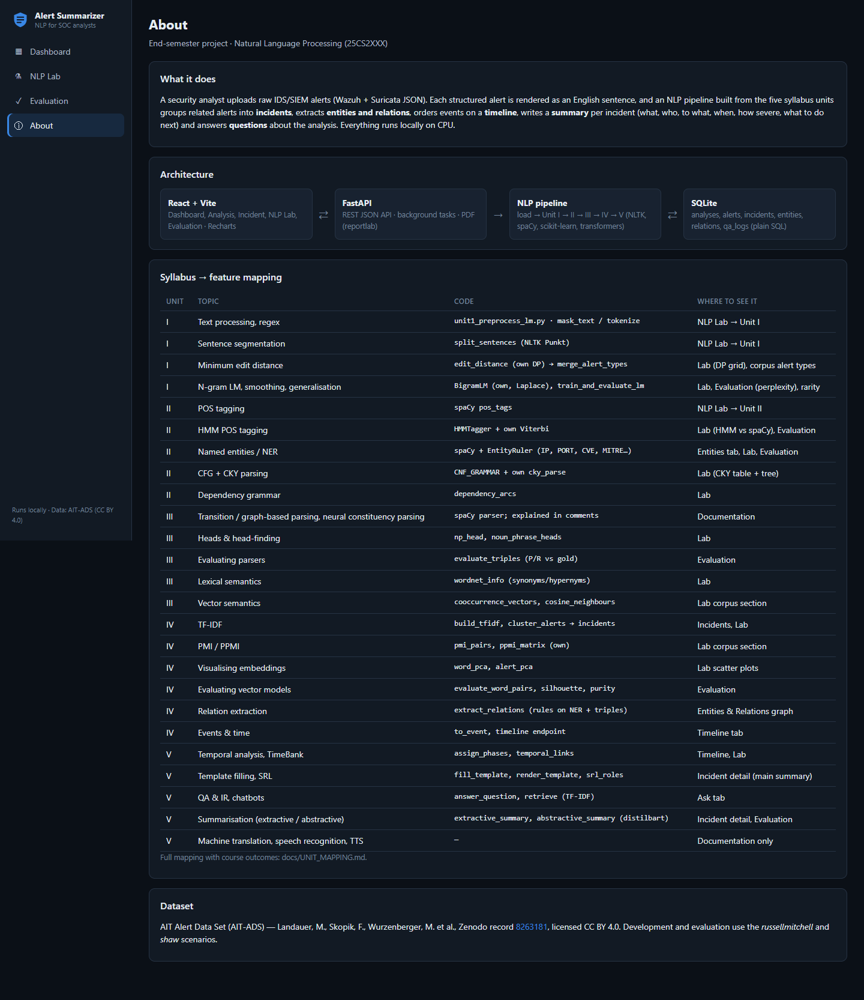
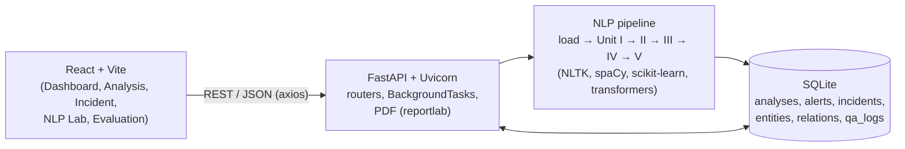

# Cybersecurity Alert Summarizer

A locally-run web application that turns raw IDS/SIEM alerts (Wazuh + Suricata JSON) into **incidents with
human-readable summaries**: what happened, who did it, to what, when, how severe and what to do next. It is the
end-semester project for *Natural Language Processing (25CS2XXX)*: every Learning Unit (I–V) of the syllabus is a stage
of the pipeline and can be demonstrated on its own in the **NLP Lab** page.


## Features

* **Upload** a Wazuh/Suricata alert file (JSON array or JSON lines) or click *Use sample data* (1,515 real AIT-ADS alerts).
* **Incidents:** related alerts grouped by TF-IDF clustering + time gaps, sorted by severity, each with a template summary,
  an extractive summary and an on-demand AI summary (distilbart, CPU).
* **Timeline** of events coloured by attack phase, **entities & relations** with a small graph, **Ask** — a Q&A chatbot
  with supporting alerts.
* **PDF export** of an incident report.
* **NLP Lab:** paste one alert and see every technique of Units I–V step by step (masking, edit-distance grid, bigram
  probabilities, HMM vs spaCy tags, NER, dependency arcs, CKY table, triples, WordNet, TF-IDF, SRL), plus corpus results
  (perplexity, merged alert types, PMI pairs, nearest neighbours, PCA scatter plots).
* **Evaluation** page with real metrics (ROUGE, NER P/R/F1, triple P/R, perplexity, silhouette, purity, word similarity).

| | |
|---|---|
|  |  |
|  |  |
|  |  |
|  |  |

## Architecture



| Stage | File | Techniques |
|---|---|---|
| Load | `backend/nlp/load_data.py` | parse Wazuh JSON, deduplicate, alert → English sentence |
| Unit I | `unit1_preprocess_lm.py` | regex masking, tokenising, sentence segmentation, **own** minimum edit distance, **own** bigram LM + Laplace smoothing, perplexity rarity score |
| Unit II | `unit2_pos_ner_parse.py` | spaCy POS, **own** HMM + Viterbi, security NER (EntityRuler), toy CFG + **own** CKY, dependency arcs |
| Unit III | `unit3_dependency_semantics.py` | dependency triples, head-finding, triple evaluation, WordNet, co-occurrence word vectors |
| Unit IV | `unit4_tfidf_ie.py` | TF-IDF + KMeans incidents, **own** PMI/PPMI, PCA, vector evaluation, relation extraction, events & time |
| Unit V | `unit5_summarize_qa.py` | temporal phases / TimeBank links, SRL, template filling, extractive + abstractive summaries, QA/IR chatbot |

Full mapping of every syllabus topic: [docs/UNIT_MAPPING.md](docs/UNIT_MAPPING.md). Viva preparation:
[docs/VIVA_NOTES.md](docs/VIVA_NOTES.md). Database design: [docs/DATABASE.md](docs/DATABASE.md). Dataset fields:
[docs/DATASET.md](docs/DATASET.md).

## Tech stack

Python 3.12 · FastAPI · Uvicorn · SQLite (`sqlite3`, hand-written SQL) · NLTK · spaCy `en_core_web_sm` · scikit-learn ·
numpy · pandas · transformers + torch (CPU) · reportlab · rouge-score · React 19 + Vite · React Router · Recharts · axios.
No cloud, no paid or external LLM APIs, no login.

## Setup and run (Windows)

Requirements: Python 3.10–3.12 and Node.js 18+ (`winget install OpenJS.NodeJS.LTS`).

```powershell
git clone https://github.com/Abin-Shaji-Thomas/Cybersecurity-Alert-Summarizer.git
cd Cybersecurity-Alert-Summarizer
.\setup.bat      # venv + pip (CPU torch), spaCy model, NLTK data, npm install, AIT-ADS download
.\start.bat      # backend on http://localhost:8000, frontend on http://localhost:5173, opens the browser
```

Manual equivalent:

```powershell
cd backend;  .venv\Scripts\python -m uvicorn main:app --port 8000      # terminal 1
cd frontend; npm run dev                                                # terminal 2
```

Other commands (from `backend/`):

```powershell
.venv\Scripts\python -m pytest -q                 # 15 tests (algorithms + API smoke test)
.venv\Scripts\python -m nlp.evaluate              # evaluation -> data/eval/results.json, docs/RESULTS.md, docs/figures/
.venv\Scripts\python -m nlp.pipeline              # run the pipeline on the sample in the terminal
```

The first click on *Generate AI summary* loads `sshleifer/distilbart-cnn-6-6` (downloaded once, about 880 MB).

## API

| Method | Path | Purpose |
|---|---|---|
| POST | `/api/analyses` | upload an alert file (multipart `file`), starts the pipeline in the background |
| POST | `/api/analyses/sample` | analyse the bundled sample |
| GET | `/api/analyses` | history |
| GET | `/api/analyses/{id}` | status (`processing` / `done` / `failed`) and stats |
| DELETE | `/api/analyses/{id}` | delete an analysis (cascades) |
| GET | `/api/analyses/{id}/incidents` | incidents sorted by severity |
| GET | `/api/analyses/{id}/timeline` | phase histogram + ordered events |
| GET | `/api/analyses/{id}/entities` | entity counts + relations for the graph |
| GET | `/api/analyses/{id}/insights` | corpus-level NLP outputs per unit |
| POST | `/api/analyses/{id}/ask` | `{question}` → `{answer, supporting_alerts}` (logged in `qa_logs`) |
| GET | `/api/analyses/{id}/qa` | Q&A history |
| GET | `/api/incidents/{id}` | incident with summaries, slots, SRL, entities, relations, alerts |
| POST | `/api/incidents/{id}/abstractive` | generate the pretrained-model summary |
| GET | `/api/incidents/{id}/pdf` | PDF incident report |
| POST | `/api/lab/process` | `{text}` → output of every unit for one alert |
| GET | `/api/evaluation` | evaluation results |
| GET | `/api/health` | health check |

Interactive docs: http://localhost:8000/docs

## Results

Measured by `python -m nlp.evaluate` on the full **russellmitchell** (21,354 alerts after deduplication) and **shaw** (30,732)
scenarios. Details and figures: [docs/RESULTS.md](docs/RESULTS.md). Gold files are drafts written by hand from the real alerts
and still need review by the student.

| Metric | Value |
|---|---|
| ROUGE-1 / 2 / L — template summary (25 references) | **0.495** / 0.196 / 0.331 |
| ROUGE-1 / 2 / L — extractive (TF-IDF centroid) | 0.329 / 0.162 / 0.246 |
| ROUGE-1 / 2 / L — abstractive (distilbart-cnn-6-6, 2.5 s each on CPU) | 0.349 / 0.166 / 0.246 |
| NER micro P / R / F1 (50 sentences, 164 entities) | 0.994 / 0.994 / 0.994 |
| Triple (actor, action, target) P / R (20 sentences) | 0.65 / 0.65 (actor 0.95, verb 0.70, target 1.00) |
| HMM (own Viterbi) vs spaCy POS agreement | 0.558 |
| Bigram held-out perplexity, unsmoothed → Laplace | ∞ → 8.31 (russellmitchell), ∞ → 11.30 (shaw) |
| KMeans k / silhouette | 7 / 0.281 (russellmitchell), 12 / 0.316 (shaw) |
| Incident purity vs attack phases (majority baseline) | 0.835 (0.624), 0.974 (0.822) |
| Word pairs: related pair scores higher than unrelated | 1.00 (21 pairs), 1.00 (14 pairs) |

Caveats: the NER gold sentences mostly follow our own sentence template, so 0.994 overstates performance on free text.
The abstractive model sometimes copies or corrupts details (e.g. a truncated IP address).

## Dataset

**AIT Alert Data Set (AIT-ADS)** — Landauer, M., Skopik, F., Wurzenberger, M., et al. Zenodo record
[8263181](https://zenodo.org/records/8263181), licensed **CC BY 4.0**. Wazuh + Suricata alerts from 8 simulated
attack scenarios. This project uses the `russellmitchell` and `shaw` scenarios; `data/sample/sample_alerts.json` is a
subset of russellmitchell. The raw data is not committed (`setup.bat` downloads it).

## Repository layout

```
backend/   main.py, routers/, db/ (schema.sql, database.py), nlp/ (one file per unit, pipeline.py, evaluate.py),
           services/ (pdf_report.py), scripts/ (download_data.py, make_sample.py), tests/
frontend/  Vite React app: src/pages, src/components, src/api.js
data/      sample/ (committed sample), eval/ (gold files, labels.csv, results.json), raw/ (downloaded, git-ignored)
docs/      UNIT_MAPPING.md, VIVA_NOTES.md, DATABASE.md, DATASET.md, RESULTS.md, figures/, screenshots/
```
