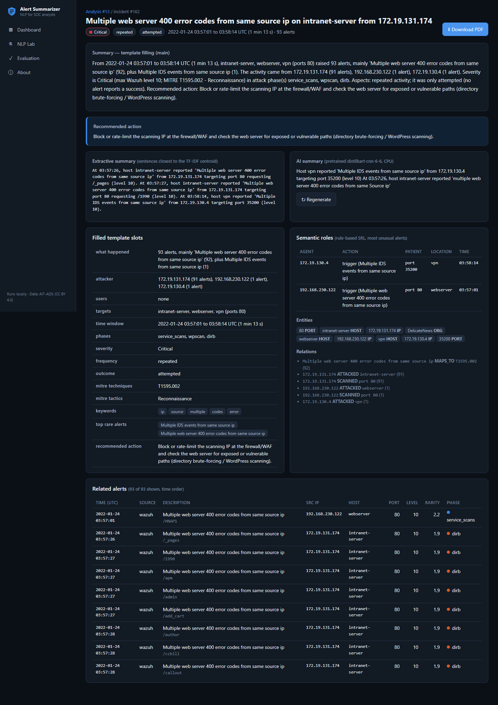
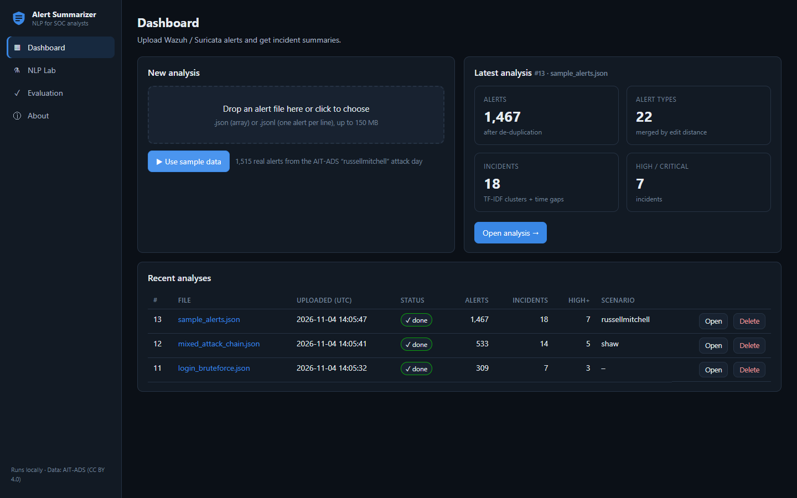
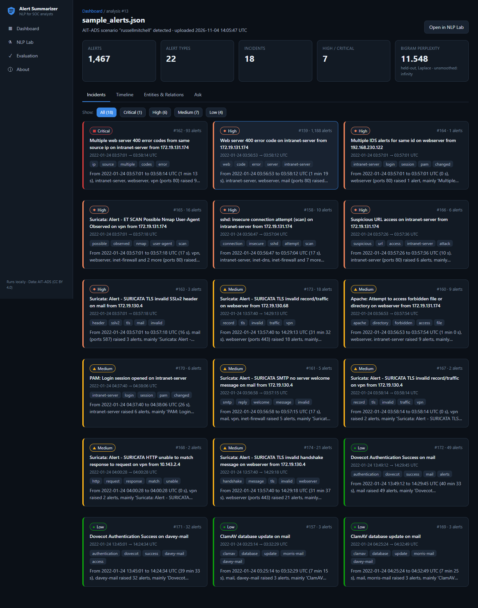
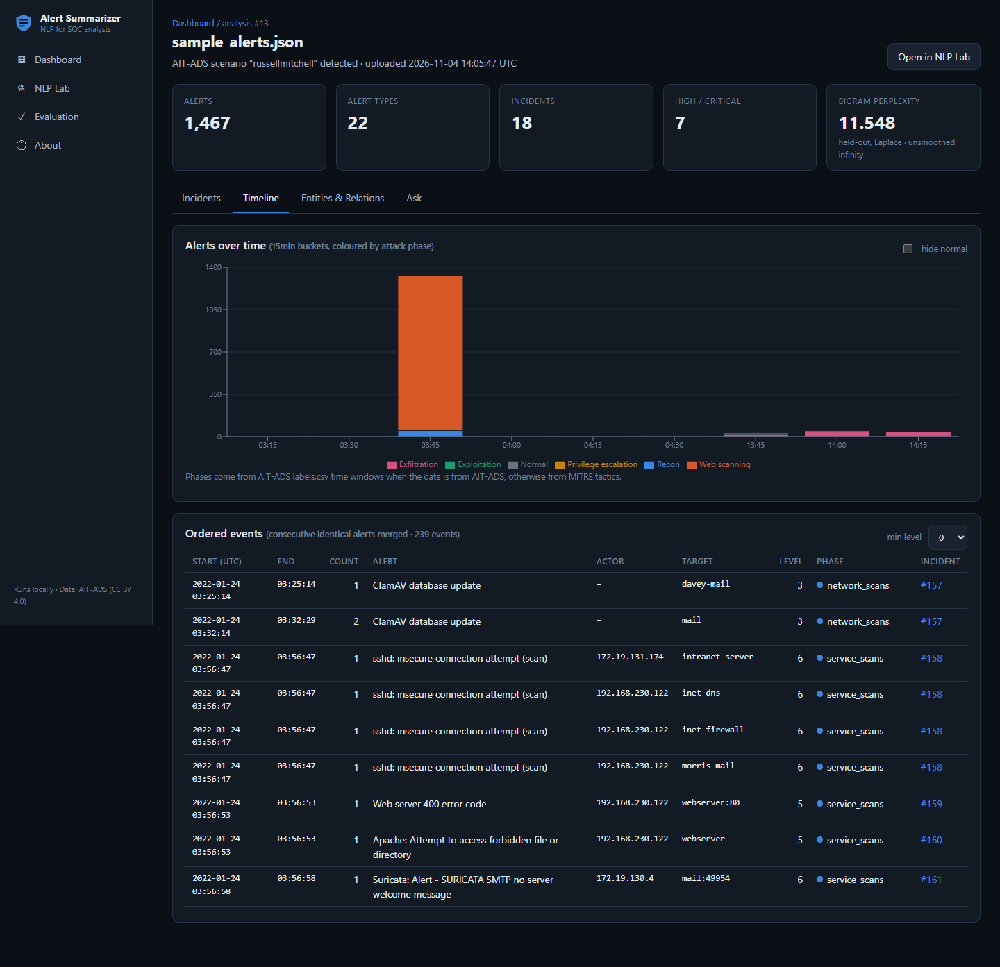
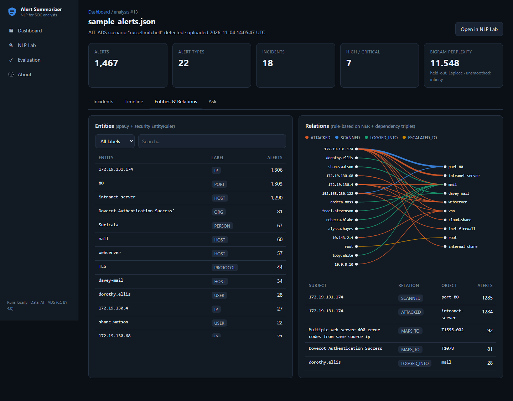
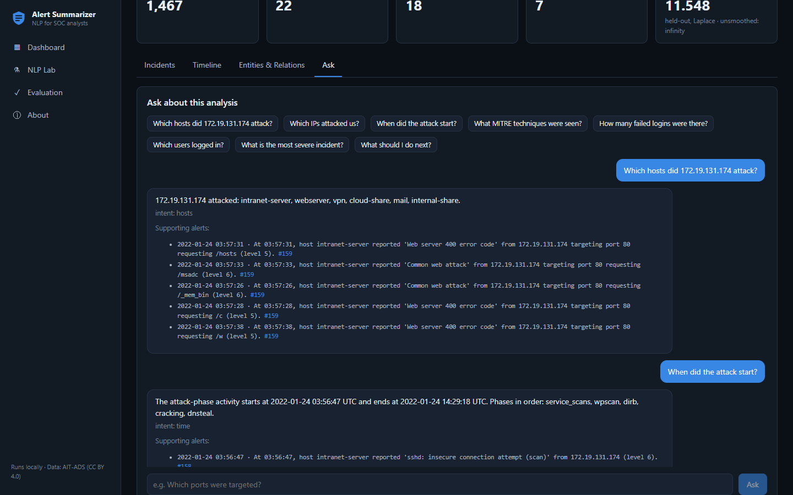
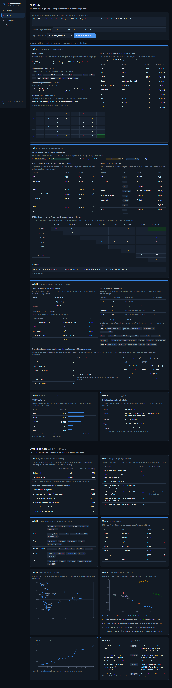
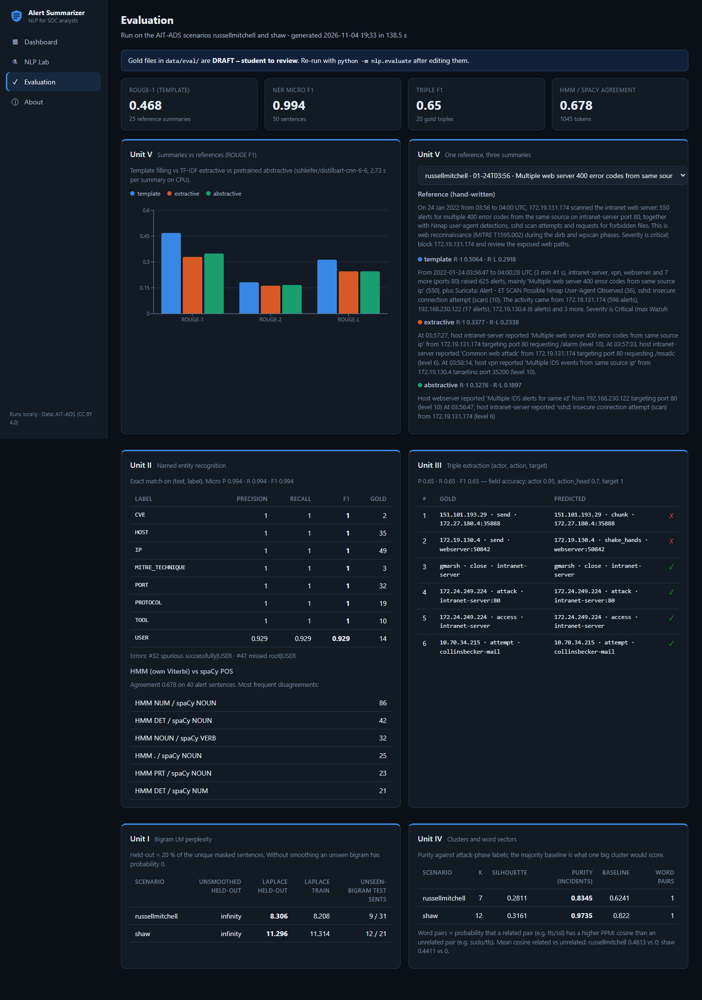

# Cybersecurity Alert Summarizer

A locally-run web application that turns raw IDS/SIEM alerts (Wazuh + Suricata JSON) into **incidents with short,
human-readable summaries**: what happened, who did it, to what, when, how severe and what to do next. Every alert is
first rewritten as an English sentence. An NLP pipeline built from the five syllabus units then groups related alerts,
extracts entities and relations, orders events on a timeline, writes a summary per incident and answers questions
about the analysis. Everything runs on a normal laptop CPU, with no cloud services and no external AI APIs.

**Author:** Abin Shaji Thomas (URK24CS6007), Karunya Institute of Technology and Sciences
**Course:** Natural Language Processing



## Features

- Upload a Wazuh/Suricata alert file (JSON array or JSON lines), or click **Use sample data**
- Processing status with live polling, and a history of analyses (open / delete)
- **Incidents** sorted by severity, each with a template summary, an extractive summary and an on-demand AI summary
- Aspect labels per incident: one-off / repeated / ongoing and attempted / succeeded
- **Timeline** coloured by attack phase, **Entities & Relations** with a relation graph, **Ask** (Q&A chat with supporting alerts)
- **PDF** incident report
- **NLP Lab**: paste one alert and see the output of every technique in Units I–V
- **Evaluation** page with real metrics

## Tech stack

| Layer | Tools |
|---|---|
| Backend | Python 3.12, FastAPI, Uvicorn |
| NLP | NLTK, spaCy `en_core_web_sm`, scikit-learn, numpy, pandas, transformers + torch (CPU), rouge-score |
| Database | SQLite through Python's `sqlite3`, hand-written `schema.sql` (no ORM) |
| PDF | reportlab |
| Frontend | React + Vite (JavaScript), React Router, Recharts, axios, plain CSS |

## Syllabus coverage

| Unit | What was implemented (file in `backend/nlp/`) |
|---|---|
| I – NLP & language modelling | Regex masking + tokenising, NLTK sentence segmentation, **own** minimum edit distance (merges alert types), **own** bigram LM with Laplace smoothing, held-out perplexity, rarity score (`unit1_preprocess_lm.py`) |
| II – POS tagging & parsing | spaCy POS, **own** HMM + Viterbi tagger, security NER (IP, PORT, HOST, USER, CVE, MITRE, PROTOCOL, TOOL), toy CFG + **own** CKY parser, dependency arcs (`unit2_pos_ner_parse.py`) |
| III – Dependency parsing & semantics | Transition-based parsing (spaCy), **own** Chu-Liu/Edmonds graph-based MST demo, head-finding, (actor, action, target) triples + evaluation, WordNet, co-occurrence word vectors (`unit3_dependency_semantics.py`) |
| IV – Embeddings & IE | TF-IDF + KMeans incidents (k by silhouette), **own** PMI/PPMI, PCA plots, vector evaluation, relation extraction, events & time (`unit4_tfidf_ie.py`) |
| V – Applications | Temporal phases + TimeBank-style links, aspect labels, rule-based SRL, template filling, extractive and abstractive summaries, QA/IR chatbot (`unit5_summarize_qa.py`) |

Machine translation, speech recognition and text-to-speech are explained in documentation only.
The full topic-by-topic table is in [docs/UNIT_MAPPING.md](docs/UNIT_MAPPING.md); viva preparation is in [docs/VIVA_NOTES.md](docs/VIVA_NOTES.md).

## Prerequisites

- Windows 10/11
- **Python 3.10–3.12** (tested with 3.12.10). Newer versions (3.13+) are not supported by spaCy/torch yet.
- **Node.js 18+** (tested with Node 26). Install with `winget install OpenJS.NodeJS.LTS` if missing.
- About 4 GB of disk space (Python packages, the AI model, the dataset)

## Installation (Windows, PowerShell)

```powershell
git clone https://github.com/Abin-Shaji-Thomas/Cybersecurity-Alert-Summarizer.git
cd Cybersecurity-Alert-Summarizer

# 1. Python virtual environment
cd backend
py -3.12 -m venv .venv
.venv\Scripts\activate

# 2. Python packages (CPU-only torch first, then the rest)
pip install torch --index-url https://download.pytorch.org/whl/cpu
pip install -r requirements.txt

# 3. spaCy model and NLTK data
python -m spacy download en_core_web_sm
python -c "import nltk; [nltk.download(p) for p in ['punkt','punkt_tab','treebank','wordnet','averaged_perceptron_tagger','universal_tagset']]"

# 4. Dataset (optional: only needed for the evaluation and for regenerating test_samples)
python scripts\download_data.py

# 5. Frontend packages
cd ..\frontend
npm install
```

`setup.bat` in the repository root does all of these steps in one go.

## How to run

Open **two terminals** in the project folder.

```powershell
# Terminal 1 - backend
cd backend
.venv\Scripts\activate
uvicorn main:app --reload --port 8000
```

```powershell
# Terminal 2 - frontend
cd frontend
npm run dev
```

Then open **http://localhost:5173** in the browser. The API runs at http://localhost:8000 (interactive docs at
http://localhost:8000/docs). `start.bat` opens both terminals and the browser for you.

Other commands (in `backend/` with the venv activated):

```powershell
python -m pytest -q          # 19 tests
python -m nlp.evaluate       # evaluation -> data/eval/results.json, docs/RESULTS.md, docs/figures/
```

## How to use

### Test samples

The folder [`test_samples/`](test_samples/) holds 9 small, ready-to-upload alert files, one story each, plus 3 broken
files for the error handling. The real ones are cut from AIT-ADS; the `synthetic_` ones are built from real alert
structures for stories the dataset does not contain:

| File | Story |
|---|---|
| `01_web_recon_scan.json` | Nmap / dirb / wpscan reconnaissance against the intranet web server (real) |
| `synthetic_02_ssh_bruteforce.json` | many failed SSH logins from one IP (AIT-ADS has no SSH failures) |
| `03_suspicious_dns_tls.json` | DNS + TLS to a suspicious `.ga` domain, possible C2 (real) |
| `04_multi_stage_attack.json` | scans → wpscan → dirb → cracking → privilege escalation, in order (real) |
| `05_normal_noise.json` | a normal morning of low-severity alerts: no High/Critical incident (real) |
| `synthetic_06_bruteforce_then_success.json` | failed logins, then a successful one (attempted → succeeded) |
| `synthetic_07_port_scan_many_hosts.json` | one IP scanning 8 hosts and 15 ports (relation graph) |
| `synthetic_08_cve_exploit.json` | exploit alerts with CVE and MITRE ids (security NER) |
| `synthetic_09_two_attackers.json` | two attackers at the same time, split into separate incidents |
| `bad_empty.json`, `bad_format.txt`, `bad_missing_fields.json` | error handling |

- [`test_samples/README.md`](test_samples/README.md): what the app shows for each file (verified results).
- [`test_samples/QUESTIONS.md`](test_samples/QUESTIONS.md): verified Ask-tab questions and 5 NLP Lab texts.
- [`test_samples/DEMO_SCRIPT.md`](test_samples/DEMO_SCRIPT.md): a 6–7 minute viva demo order.

### Walkthrough

1. **Dashboard:** drag `test_samples/04_multi_stage_attack.json` onto the upload box, or click **Use sample data**. The status
   shows *processing* and changes to *done* after a few seconds. Uploading `test_samples/bad_format.txt` shows an error.
   
2. **Open analysis → Incidents:** cards sorted by severity, with keywords and a summary preview.
   
3. **Timeline:** alerts per time bucket, coloured by attack phase, plus the ordered event list.
   
4. **Entities & Relations:** the entity table (filter by label) and the attacker → target relation graph.
   
5. **Ask:** type a question such as *Which IP attacked the server?*, *When did the attack start?* or
   *Did the attacker log in successfully?* (verified questions per file in `test_samples/QUESTIONS.md`).
   
6. **Incident detail** (click a card): template summary, aspect badges, extractive summary, **Generate AI summary**,
   filled slots, semantic roles, related alerts and **Download PDF**.
7. **NLP Lab:** paste an alert sentence and click **Run through Units I–V** to see every technique step by step.
   
8. **Evaluation** and **About** pages.
   

## API endpoints

| Method | Path | Purpose |
|---|---|---|
| POST | `/api/analyses` | upload an alert file (multipart field `file`) |
| POST | `/api/analyses/sample` | analyse the bundled sample |
| GET | `/api/analyses` | history |
| GET / DELETE | `/api/analyses/{id}` | status + stats / delete (cascades) |
| GET | `/api/analyses/{id}/incidents` | incidents sorted by severity |
| GET | `/api/analyses/{id}/timeline` | phase histogram + ordered events |
| GET | `/api/analyses/{id}/entities` | entities + relations |
| GET | `/api/analyses/{id}/insights` | corpus-level NLP results per unit |
| POST | `/api/analyses/{id}/ask` | `{question}` → answer + supporting alerts |
| GET | `/api/incidents/{id}` | full incident |
| POST | `/api/incidents/{id}/abstractive` | generate the AI summary |
| GET | `/api/incidents/{id}/pdf` | PDF report |
| POST | `/api/lab/process` | `{text}` → output of every unit |
| GET | `/api/evaluation` | evaluation results |
| GET | `/api/health` | health check |

## Project structure

```
Cybersecurity-Alert-Summarizer/
├── README.md, setup.bat, start.bat, .gitignore
├── backend/
│   ├── main.py, requirements.txt
│   ├── routers/        analyses.py, incidents.py, lab.py, evaluation.py
│   ├── db/             schema.sql, database.py
│   ├── nlp/            load_data.py, unit1_…unit5_*.py, pipeline.py, evaluate.py
│   ├── services/       pdf_report.py, analysis_service.py
│   ├── scripts/        download_data.py, make_sample.py, make_test_samples.py
│   └── tests/          test_nlp.py, test_api.py
├── frontend/           Vite React app: src/pages, src/components, src/api.js
├── data/
│   ├── sample/         sample_alerts.json (bundled sample)
│   ├── eval/           gold files, labels.csv, results.json
│   └── raw/            downloaded dataset (not in git)
├── test_samples/       ready-to-upload example files + README, QUESTIONS, DEMO_SCRIPT
└── docs/               UNIT_MAPPING, VIVA_NOTES, DATABASE, DATASET, RESULTS, figures/, screenshots/
```

## Database tables

SQLite file `data/app.db` (created automatically). Every child table uses `ON DELETE CASCADE`. Details and the ER
diagram are in [docs/DATABASE.md](docs/DATABASE.md).

| Table | One row = |
|---|---|
| `analyses` | one uploaded file: status, counts, perplexities, corpus insights |
| `alerts` | one deduplicated alert: fields, English sentence, rarity, cluster, phase, triple |
| `incidents` | one group of alerts: severity, summaries, filled template slots |
| `entities` | one entity mention in one alert |
| `relations` | one (subject, relation, object) fact in one incident |
| `qa_logs` | one question asked in the Ask tab |

## Results

From `python -m nlp.evaluate` on the full **russellmitchell** (21,354 alerts) and **shaw** (30,732 alerts) scenarios.
Details and figures: [docs/RESULTS.md](docs/RESULTS.md).

| Metric | Value |
|---|---|
| ROUGE-1 / 2 / L, template summary (25 references) | **0.463** / 0.180 / 0.310 |
| ROUGE-1 / 2 / L, extractive (TF-IDF centroid) | 0.329 / 0.162 / 0.246 |
| ROUGE-1 / 2 / L, abstractive (distilbart-cnn-6-6, CPU) | 0.349 / 0.166 / 0.246 |
| NER micro P / R / F1 (50 sentences, 164 entities) | 0.994 / 0.994 / 0.994 |
| Triples (actor, action, target) P / R (20 sentences) | 0.65 / 0.65 (actor 0.95, verb 0.70, target 1.00) |
| HMM (own Viterbi, masked input) vs spaCy POS agreement | 0.678 |
| Bigram held-out perplexity, unsmoothed → Laplace | ∞ → 8.31 (russellmitchell), ∞ → 11.30 (shaw) |
| KMeans k / silhouette | 7 / 0.281, 12 / 0.316 |
| Incident purity vs attack phases (majority baseline) | 0.835 (0.624), 0.974 (0.822) |
| Word pairs: related pair scores higher than unrelated | 1.00 (21 pairs), 1.00 (14 pairs) |

Honest caveats:
- The gold files in `data/eval/` are hand-written drafts that still need review by the student.
- NER 0.994 is inflated: most gold sentences follow the app's own sentence template, which the rules were written for.
- Triple errors are mostly wrong verbs (e.g. "400 error code" gives no verb; the gold label is "request").
- The AI summary mostly copies alert sentences and once shortened an IP address; the template summary is the reliable one.
- The template's aspect sentence and its recommended action (now taken from the most severe alerts) are not worded like the references, so ROUGE dropped a little (0.495 → 0.463 ROUGE-1).
- The perplexity test sets are small (31 / 21 unique sentence patterns), because masking makes many alerts identical.
- The HMM agreement is agreement, not accuracy: there is no gold POS for alert text.

## Troubleshooting

| Problem | Fix |
|---|---|
| `Address already in use` / port 8000 or 5173 busy | Close the other server, or use another port: `uvicorn main:app --reload --port 8001` (then set `VITE_API_URL=http://localhost:8001` before `npm run dev`). Vite picks the next free port itself. |
| `.venv\Scripts\activate` is blocked in PowerShell | Run once: `Set-ExecutionPolicy -Scope CurrentUser RemoteSigned` |
| `Can't find model 'en_core_web_sm'` | With the venv active: `python -m spacy download en_core_web_sm` |
| NLTK `LookupError` (punkt, wordnet, ...) | Run the NLTK download command from the installation step 3 again |
| Frontend shows *Cannot reach the backend* | Start the backend first (terminal 1) and check http://localhost:8000/api/health |
| `npm install` / `npm run dev` errors | Check `node --version` is 18 or newer; delete `frontend/node_modules` and run `npm install` again |
| First **Generate AI summary** is slow | The first click downloads `sshleifer/distilbart-cnn-6-6` (about 880 MB) once; later runs take a few seconds. Without internet it shows a clear error and the other summaries still work. |
| `--reload` does not pick up a code change | Press Ctrl+C in the backend terminal and start uvicorn again |
| Evaluation says the dataset is missing | `python scripts\download_data.py` in `backend/` |

## Dataset credit

**AIT Alert Data Set (AIT-ADS)**: Landauer, M., Skopik, F., Wurzenberger, M., et al. Zenodo record
[8263181](https://zenodo.org/records/8263181), licensed **CC BY 4.0**. Wazuh + Suricata alerts from 8 simulated
multi-step attack scenarios. This project uses the `russellmitchell` and `shaw` scenarios; the bundled sample and the
test samples are subsets of them. Field details: [docs/DATASET.md](docs/DATASET.md).
