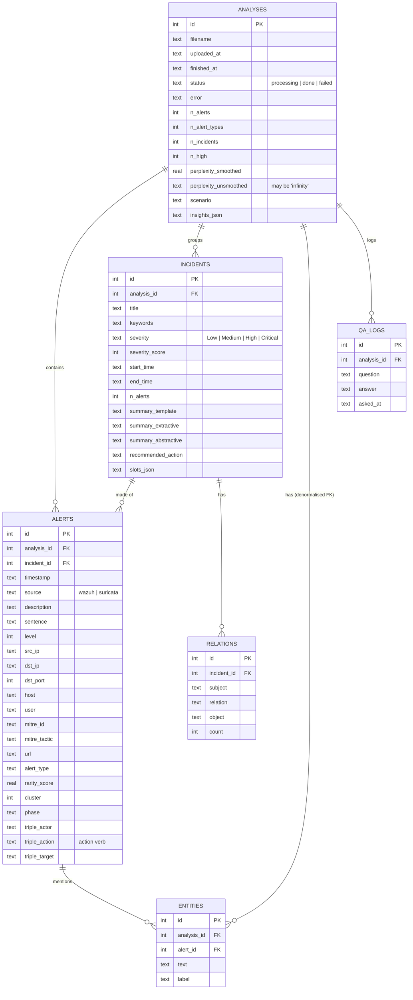

# Database (SQLite, plain SQL)

The schema is hand-written in [`backend/db/schema.sql`](../backend/db/schema.sql) and executed by
`db.database.init_db()` when the API starts. All queries are plain SQL in
[`backend/db/database.py`](../backend/db/database.py) (Python's built-in `sqlite3`, no ORM).
The database file is `data/app.db` (git-ignored; override with the `ALERT_DB` environment variable).

## ER diagram



## Tables

| Table | One row = | Notes |
|---|---|---|
| `analyses` | one uploaded file (or the sample) | `status` is set to `processing` on upload and to `done` / `failed` by the background task; the frontend polls it. `insights_json` holds the corpus-level NLP outputs shown in the NLP Lab (perplexities, PMI pairs, PCA coordinates...). |
| `incidents` | one group of related alerts | Produced by TF-IDF clustering + time-gap splitting. Holds the three summaries and the filled template slots (`slots_json`). `summary_abstractive` stays NULL until the user clicks *Generate AI summary*. |
| `alerts` | one deduplicated alert | Structured fields from the raw JSON, plus every per-alert NLP output: the English `sentence`, merged `alert_type`, `rarity_score` (bigram perplexity), `cluster`, attack `phase` and the dependency triple. |
| `entities` | one entity mention in one alert | Output of the security NER (IP, PORT, HOST, USER, CVE, MITRE_TECHNIQUE, PROTOCOL, TOOL + spaCy labels). |
| `relations` | one (subject, relation, object) fact in one incident | e.g. `(172.19.131.174, ATTACKED, intranet-server)`; `count` = number of supporting alerts. |
| `qa_logs` | one question asked in the Ask tab | History of the Q&A chatbot. |

## Design choices (normalisation)

* **Ownership by foreign keys with `ON DELETE CASCADE`.** Every row belongs to one analysis, so
  `DELETE FROM analyses WHERE id = ?` removes everything of that analysis. SQLite only enforces foreign keys
  when `PRAGMA foreign_keys = ON` is set, which `database.connect()` does on every connection.
* **Mostly 3NF.** Entities and relations are separate tables (one-to-many) rather than lists inside an alert
  row, so they can be counted with `GROUP BY` (e.g. the entity table = `SELECT text, label, COUNT(*) ... GROUP BY text, label`).
* **Deliberate denormalisation**, each for one query:
  * `entities.analysis_id` could be derived through `alerts`, but storing it avoids a join for the
    analysis-wide entity list (the most frequent query).
  * The counters in `analyses` (`n_alerts`, `n_incidents`, ...) could be computed with `COUNT(*)`; they are
    stored once when processing finishes so the history table loads instantly.
  * `slots_json` and `insights_json` are JSON text: they are written once, always read as a whole and never
    queried by field, so splitting them into tables would add complexity without benefit.
* **Indexes** on every foreign key and on `(analysis_id, timestamp)` for the timeline (SQLite does not index
  foreign keys automatically).
* Timestamps are stored as ISO-8601 UTC text, which sorts correctly as text.

## Example queries used by the API

```sql
-- relations of a whole analysis, summed over incidents (Entities & Relations graph)
SELECT r.subject, r.relation, r.object, SUM(r.count) AS count
FROM relations r JOIN incidents i ON i.id = r.incident_id
WHERE i.analysis_id = ? GROUP BY r.subject, r.relation, r.object ORDER BY count DESC;

-- incident list sorted by severity
SELECT id, title, severity, start_time, end_time, n_alerts FROM incidents
WHERE analysis_id = ? ORDER BY severity_score DESC, n_alerts DESC;
```
