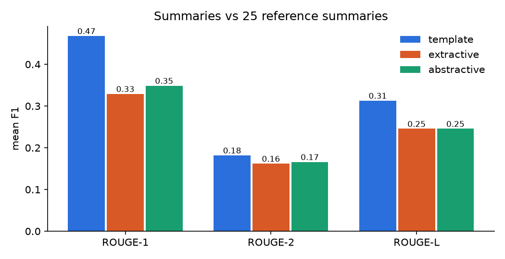
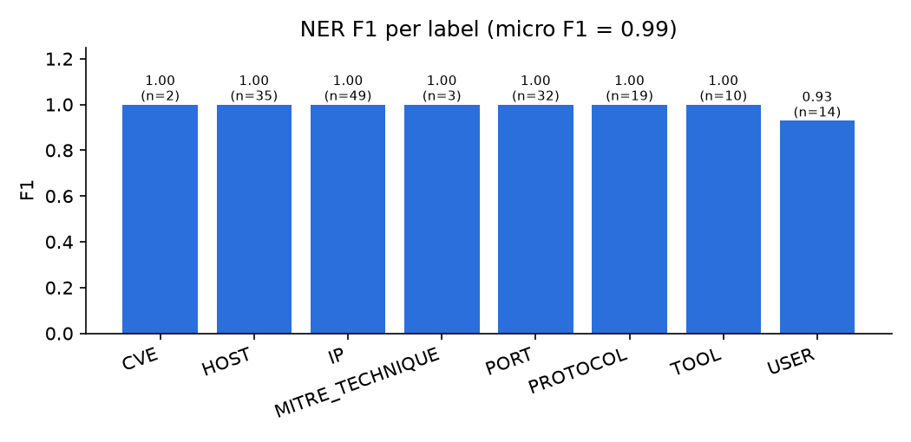
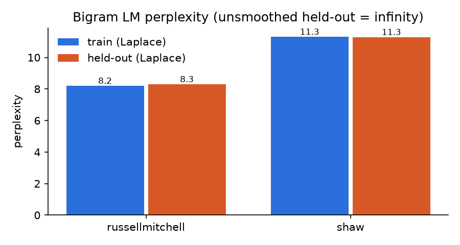
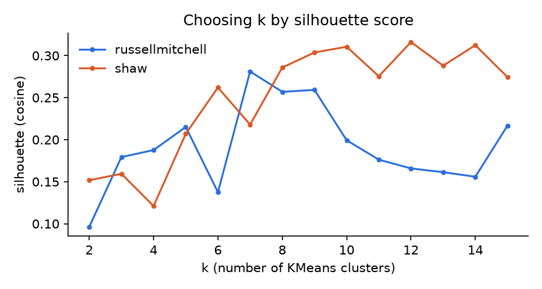
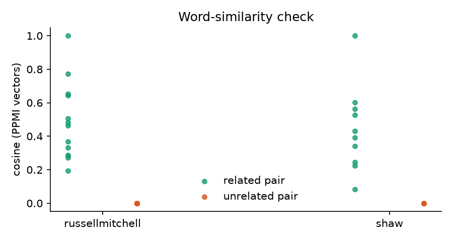

# Results

Generated by `python -m nlp.evaluate` on 2026-11-04 19:33 (total 138.5 s). Every number below comes from that run; the JSON version is `data/eval/results.json`.

Gold files (`data/eval/*.csv`) are **DRAFT – student to review**: hand-labelled from the real alerts, but not yet checked by a second annotator.

## Data

| Scenario | Alerts (deduplicated) | Alert types | Incidents | High/Critical | Pipeline time |
|---|---|---|---|---|---|
| russellmitchell | 21,354 | 33 | 214 | 61 | 27.5 s |
| shaw | 30,732 | 36 | 444 | 124 | 30.4 s |

## Unit V – Summarisation (ROUGE F1, mean over matched incidents)

25 of 25 reference summaries matched an incident (same scenario, start time and main alert type).

| System | ROUGE-1 | ROUGE-2 | ROUGE-L |
|---|---|---|---|
| template | 0.4681 | 0.1820 | 0.3131 |
| extractive | 0.3293 | 0.1621 | 0.2456 |
| abstractive | 0.3489 | 0.1661 | 0.2457 |

Abstractive model: `sshleifer/distilbart-cnn-6-6` on CPU, 2.73 s per summary.

## Unit II – Named entity recognition

50 sentences, exact match on (text, label). Micro P = 0.994, R = 0.994, **F1 = 0.994**.

| Label | Precision | Recall | F1 | Gold |
|---|---|---|---|---|
| CVE | 1.0 | 1.0 | 1.0 | 2 |
| HOST | 1.0 | 1.0 | 1.0 | 35 |
| IP | 1.0 | 1.0 | 1.0 | 49 |
| MITRE_TECHNIQUE | 1.0 | 1.0 | 1.0 | 3 |
| PORT | 1.0 | 1.0 | 1.0 | 32 |
| PROTOCOL | 1.0 | 1.0 | 1.0 | 19 |
| TOOL | 1.0 | 1.0 | 1.0 | 10 |
| USER | 0.929 | 0.929 | 0.929 | 14 |

HMM (own Viterbi, trained on the NLTK treebank sample) vs spaCy POS agreement on 40 alert sentences (1045 tokens): **0.678**. This is agreement, not accuracy; there is no gold POS for alert text.

## Unit III – Triple extraction (actor, action, target)

20 gold sentences. A triple counts as correct only if all three parts match. Precision = 0.65, Recall = 0.65, F1 = 0.65.

| Field | Accuracy |
|---|---|
| actor | 0.95 |
| action_head | 0.7 |
| target | 1.0 |

## Unit I – Bigram language model (perplexity)

| Scenario | Unsmoothed held-out PP | Laplace held-out PP | Laplace train PP | Test sentences with an unseen bigram |
|---|---|---|---|---|
| russellmitchell | infinity | 8.306 | 8.208 | 9 of 31 |
| shaw | infinity | 11.296 | 11.314 | 12 of 21 |

## Unit IV – Clustering and vectors

| Scenario | k | Silhouette | Purity (clusters) | Purity (incidents) | Majority baseline | Word pairs: related > unrelated |
|---|---|---|---|---|---|---|
| russellmitchell | 7 | 0.2811 | 0.8216 | 0.8345 | 0.6241 | 1.0 (21 pairs) |
| shaw | 12 | 0.3161 | 0.9649 | 0.9735 | 0.822 | 1.0 (14 pairs) |

Purity is measured against the attack-phase label of each alert (labels.csv time windows). Most alerts are `normal` background, so the majority baseline is already high; incidents beat it because they also split on time gaps.

Word pairs: probability that a hand-picked related pair has a higher cosine than an unrelated pair (PPMI-weighted co-occurrence vectors; counts-only vectors are in results.json).

